# 文献阅读坞 · Paper Reader

> 在 DSH（DeepSeek Harness）窗口左侧开一条可拖宽的「阅读坞」：论文原版排版、每个字可选中；选中即解释、按句缓存、术语自动累积；整段翻译、框选公式、全文搜索、目录、引用跳转、高亮批注与笔记导出——全部在本机完成。

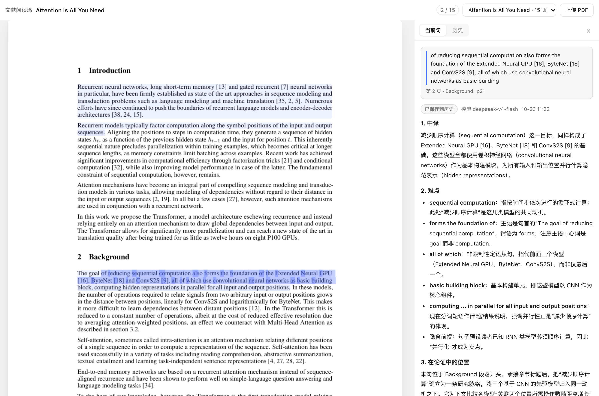

---

## 它解决什么问题

外文论文的阅读流程通常是割裂的：PDF 阅读器负责显示，翻译软件负责翻译，网页版 AI 负责解释，笔记软件负责沉淀，最后还要在文献管理器里归档。每换一个工具，位置、上下文、已经查过的东西就丢一次。

这个插件把这些事放回**一个窗口**里：

- 论文在左边，聊天在右边，DSH 的对话能力直接贴着论文；
- 读不懂的句子选一下，回答里带着「论文题目 + 章节 + 页码 + 所在段落 + 前后段」；
- 同一句第二次点开**不重新调模型、不花钱**；
- 解释过、翻译过、框选过的东西都留在本地，随时回看、导出。

## 为什么和市面上的不一样

| | 云 AI 阅读（ChatPDF / SciSpace 类） | Zotero 插件类 | **本插件** |
|---|---|---|---|
| 论文排版 | 重新排版或纯文本 | 原版 | **原版**：页图 + 精确文字层，公式/双栏/图表不重排 |
| 解释上下文 | 全文或单段 | 取决于插件 | 段落 + 章节 + 页码 + 前后段，**按句缓存** |
| 重复提问成本 | 每次都调模型 | 每次都调模型 | **命中缓存 0 token**（本地实测第二次 0.019s） |
| 术语 | 少数工具支持 | 少见 | **自动累积**：解释时顺带产出，可导出 Markdown |
| 隐私 | 论文上传到第三方 | 本地 | **全本机**：PDF、页图、解释、批注均不出本机（只有发问的文本片段会调模型） |
| 与对话打通 | 独立应用 | 无 | 一键把「原句 + 上下文 + 已有解释」送进 DSH 对话继续追问 |

## 功能一览

**读**

- 原版面渲染：PDF 转 1.5× 页图 + 逐词坐标文字层，**每个字都能选中、复制**，选区高亮贴合原词位置；
- 全文搜索（⌘F）：命中标黄、计数、上下条跳转；
- 目录导航：按 PDF 自带 TOC 缩进，点章节跳转；
- 缩放 70–200%、阅读位置保持；`j/k/g/G/[ ]` 快捷键；
- 引用 / 图表跳转：点 `[12]` 跳参考文献、点 `Figure 2` 跳图，带「← 返回」；⌥+点击弹出**双开对照**小窗；
- 高亮批注：4 色、可写备注，原文色块渲染，不挡选词。

**懂**

- 选中解释：三段式（中译 / 难点 / 在论证中的位置），自动带上下文；
- 按句缓存 + 历史：原文留淡色标记，点开即旧解释；
- 整段翻译：中英自动判方向，公式符号保留；
- 框选公式/图区域解释：按区域文字层 + 上下文逐符号讲解（纯图区域会明确说明只能推测）；
- 术语表：自动累积、点击跳回首次出现、一键导出 `.md`。

**管**

- 论文库：历史/术语旁的页签，按标题列出所有上传过的论文，一键切换、打开原始 PDF；
- 原始文件完整保留：`docs/<sha>/source.pdf`，抽取不丢原件；
- 笔记导出：批注按页分组 + 术语表 → `notes.md`，直接进 Obsidian；
- 解释、翻译、公式、批注全部有历史，不覆盖、可回看。

## 截图

**选中一句 → 带上下文解释，会话内可追问**


**同一句再点一次：缓存命中，0 次模型调用**

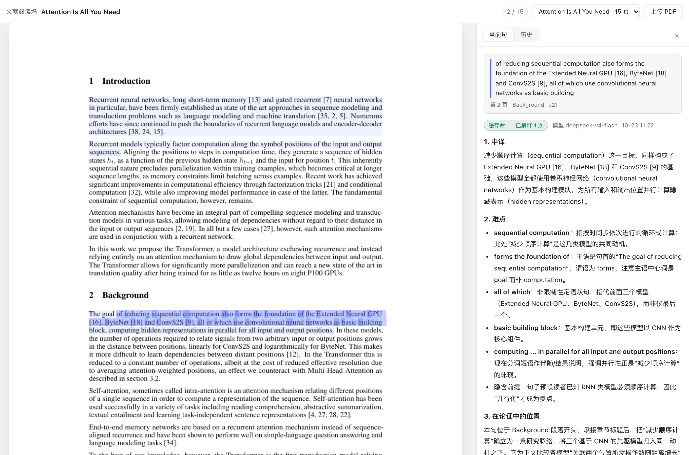

**整段翻译（自动判中英方向）**

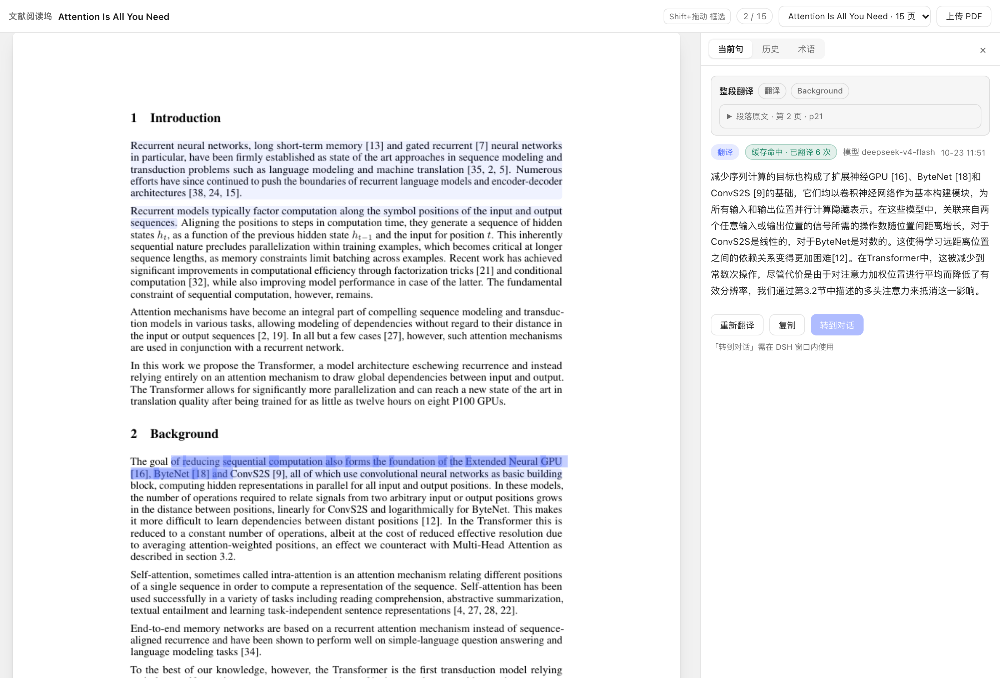

**Shift 框选公式区域 → 逐符号解释**

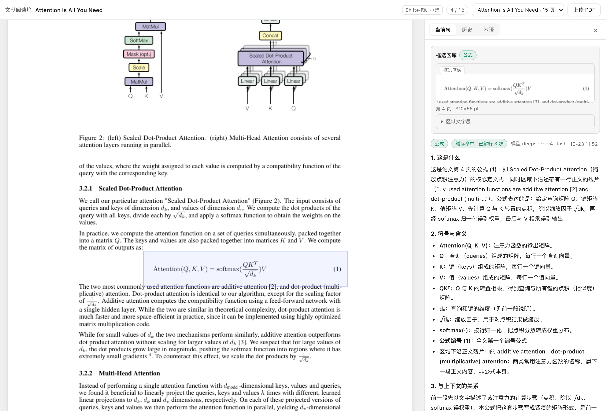

**术语表：解释时自动累积，零额外调用**

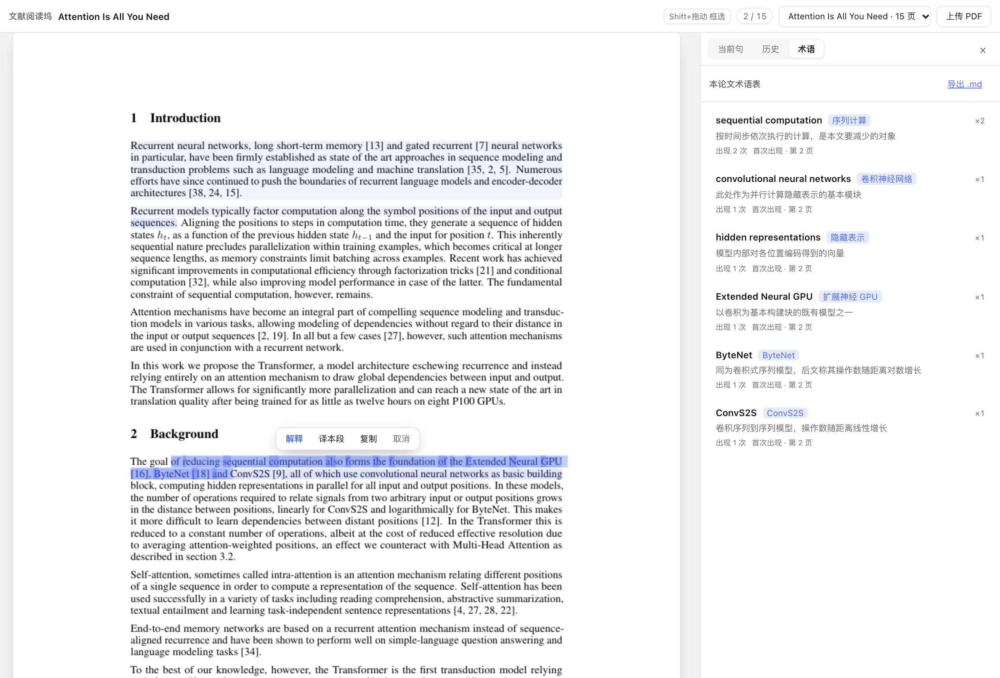

**论文库：所有上传过的论文，按标题列**

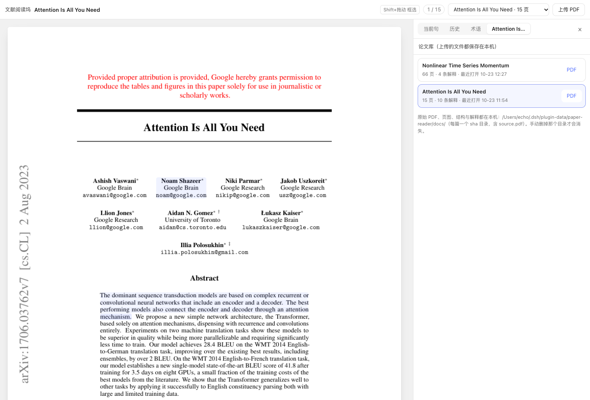

**全文搜索**

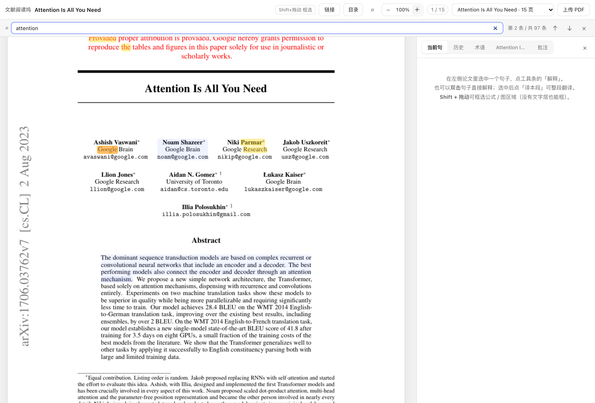

**目录导航**

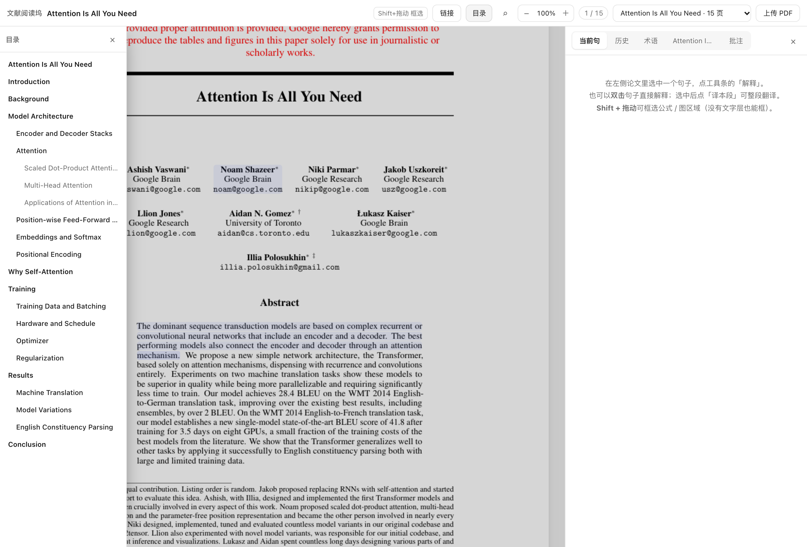

**引用跳转 + 双开对照（不打断当前阅读位置）**

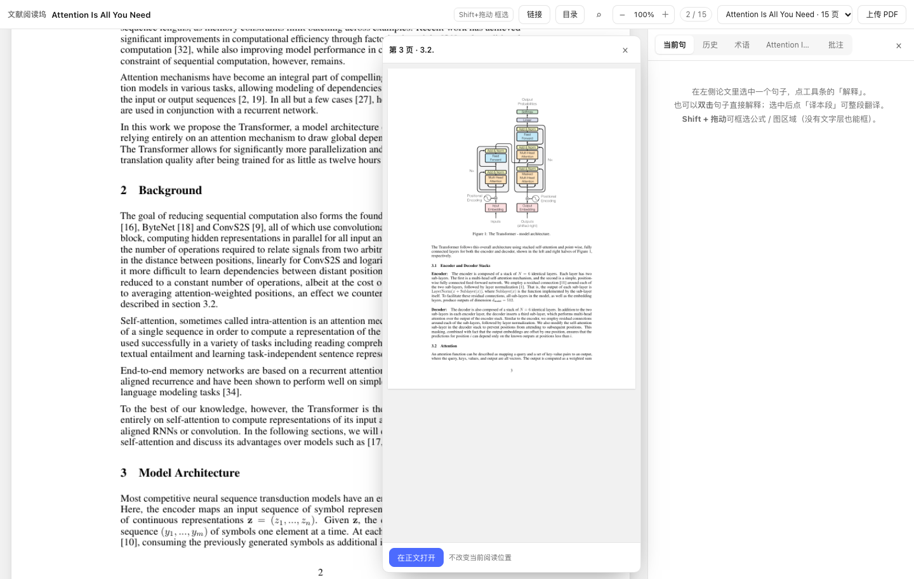

**高亮批注与笔记导出**

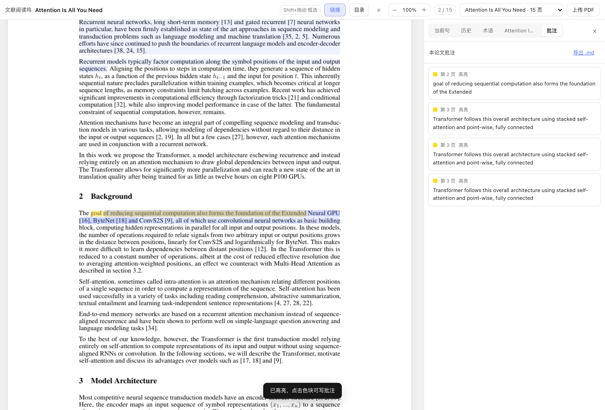

**整体形态：论文在左，聊天在右（布局验收脚本在同构 DSH 框架上的截图）**

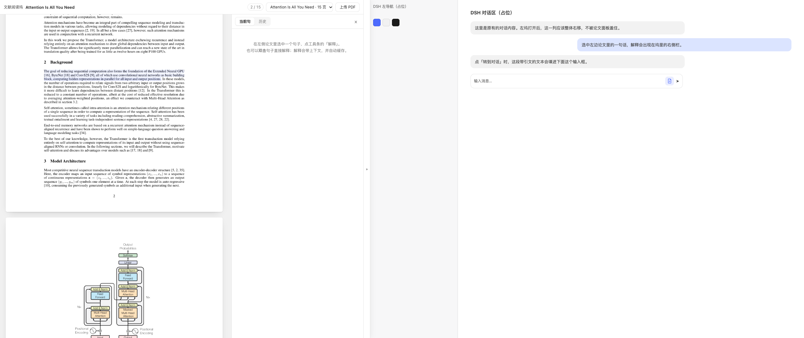

## 安装

**前提**

- macOS + 已安装 DeepSeek Harness（本插件是 DSH 插件，宿主与客户端都在 DSH 里运行）；
- `python3`（系统自带即可）并安装 PyMuPDF：`python3 -m pip install PyMuPDF`；
- DSH 里已配置好 DeepSeek API Key（解释/翻译走本机 DSH 的 LLM 路由）。

**安装到 DSH**

```bash
git clone https://github.com/Echo-Tian1/dsh-paper-reader.git
cd dsh-paper-reader
./install.sh            # 软链进 ~/.dsh/profiles/desktop，并登记 bundle
```

然后 **Cmd+Q 退出 DSH 再打开**。装好后，输入框工具行会出现一个「文献」按钮，点它开坞。

> 想换 profile：`PROFILE=web ./install.sh`；卸载：`./install.sh --remove`（数据目录保留）。

**不安装也能先看**

预览服务器复用同一套宿主代码，直接在浏览器打开阅读器：

```bash
pip install PyMuPDF
REAL_LLM=1 PORT=18080 node tests/serve.mjs
# 打开 http://127.0.0.1:18080/dsh-paper-reader/app/
```

预览页没有 DSH 主题与「转到对话」桥，其余（渲染、选区、解释、缓存、术语、搜索、目录、批注）一致。

## 用法

| 动作 | 结果 |
|---|---|
| 拖 PDF 进页面 / 「上传 PDF」 | 抽取约 0.7 秒，打开第一页 |
| 选中一句 →「解释」 | 三段式解释；命中缓存则秒出 |
| 双击句子 | 直接解释 |
| 点原文淡色标记 | 打开该句历史解释（不调模型） |
| 选中 →「译本段」 | 整段译文 |
| Shift + 拖动 | 框选区域 → 「解释这块」 |
| 「重新解释」 | 强制重调模型，新条目 `supersedes` 旧条目，历史都保留 |
| 「转到对话」 | 填进 DSH 当前会话输入框，可改完再发 |
| ⌘F / 顶栏 ⌕ | 全文搜索 |
| 顶栏「目录」/「链接」 | 目录导航 / 引用跳转开关 |
| ⌥ + 点击链接 | 内部链接：双开对照；外链：新标签 |
| 选中 →「高亮」 | 生成批注；点色块写备注、换色、删除 |
| 批注 tab「导出 .md」 | 导出笔记（批注 + 术语表） |
| 坞右侧 ⤢ / Esc | 专注阅读（铺满窗口、隐藏对话栏）/ 退出 |
| 拖坞右边界 | 调宽；宽度与专注偏好记在 localStorage |

**快捷键**：`j/k` 滚动、`g/G` 文首/文末、`[`/`]` 翻页、`⌘F` 搜索、`⌘+/-/0` 缩放、`Esc` 逐层关闭浮层。

## 配置

在 `~/.dsh/profiles/desktop/cordis.patch.yml` 的 `paper-reader` 行覆盖（缺省值在 `index.js` 的 `DEFAULTS`）：

```yaml
- id: paper-reader
  name: '@local/paper-reader'
  config:
    provider: deepseek-official
    model: deepseek-v4-flash     # 难句可换 deepseek-v4-pro
    temperature: 0.3
    maxTokens: 4096              # 解释/翻译/区域解释的输出上限
    reasoningEffort: 'off'       # 按调用关思考（见下方说明）
    pythonPath: python3          # 需能 import fitz
    maxUploadMB: 80
    extractTimeoutMs: 120000
    dockWidthRatio: 0.46         # 坞宽 = clamp(ratio*vw, 720, min(1280, .62vw))
    explanationPaneWidth: 420
    autoCollapseSidebar: true
```

> **为什么要关思考**：DeepSeek 的 thinking token 与正文共享 `maxTokens`，解释是长输出，开着思考会把正文挤到上限（`finish:max-tokens`）。三个链路默认按调用传 `reasoningEffort: 'off'`；要更深的分析可改 `'high'` 并把 `maxTokens` 提到 8000+。

## 数据与隐私

```
~/.dsh/plugin-data/paper-reader/
├── index.json                  # 论文列表
├── ui-state.json               # 上次打开的论文、每篇最后页码
└── docs/<sha256 前 16 位>/
    ├── source.pdf              # 你上传的原始文件（完整保留）
    ├── structure.json          # 章节 / 段落 / 切句
    ├── pages/<n>.json          # 逐词坐标
    ├── pages/<n>.png           # 1.5× 页图
    ├── links.json              # 引用/图表/外链（老论文首次访问惰性回填，~130ms）
    ├── explanations.json       # 解释与历史
    ├── terms.json              # 术语表
    └── annotations.json        # 高亮与批注
```

- PDF、页图、结构、解释、批注**全部只在本机**；只有「选中的句子 + 上下文」这一段文本会发给你配置的模型；
- 预览服务器与插件共用这套目录；删掉目录即清空（不可恢复）；
- 重复上传同一个 PDF 按 sha256 去重，直接复用。

## 架构

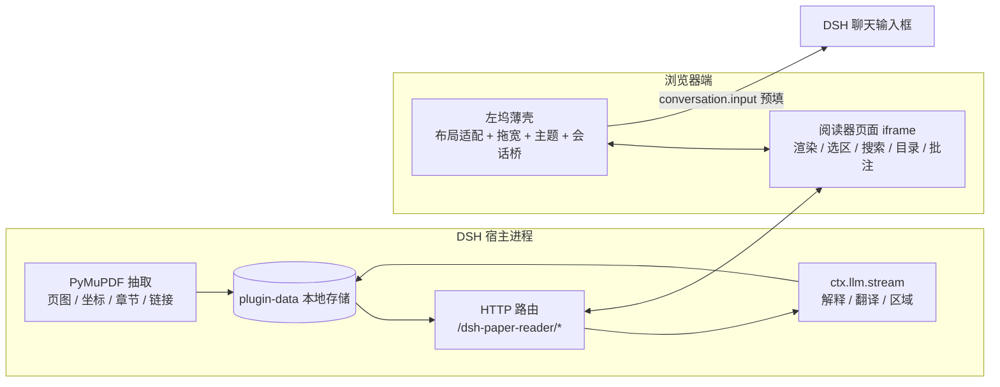

- **宿主半**（Node + Python）：抽取、页图、静态页、缓存、LLM 调用、批注与导出；
- **阅读器页面**（原生 HTML/CSS/ES Modules，零构建，无第三方依赖）：所有阅读交互；
- **客户端薄壳**（React，无 JSX）：在 DSH 里开左坞（给三栏框架加 `padding-left` 把内容右推）、拖宽/收起/专注、下发主题、把「转到对话」接进当前会话；
- 接口契约见 [`CONTRACT.md`](CONTRACT.md)，设计与取舍见 [`docs/design.md`](docs/design.md)、[`docs/plan.md`](docs/plan.md)。

## 测试

```bash
# 宿主半：89 条（放入夹具 PDF 后全跑；没有夹具时依赖真实论文的用例自动 skip）
PR_FIXTURE=/path/to/1706.03762v7.pdf node --test

# 阅读器纯函数与静态契约：60 条
node app/fixture/selfcheck.mjs
```

覆盖：抽取产物结构、逐词坐标、切句覆盖、链接抽取与惰性回填、批注 CRUD 与并发、缓存键与 supersedes、SSE 事件形状、术语合并、笔记导出注入防护、搜索结果与缩放换算、链接/批注命中、快捷键映射等。

## 已知边界

- **只支持带文字层的 PDF**：扫描件能显示但选不中（页面会提示）；
- **公式/图区域选不中**：公式多是矢量字形，走「Shift 框选 → 区域文字层 + 上下文」解释；**本插件不把图片发给模型**（DeepSeek 适配器是纯文本的），纯图区域会明确说明只能按上下文推测；
- **段落与切句是启发式**：极少数 PDF 会把整栏并成一段，解释始终带整段与相邻段上下文；
- **跨页选区只高亮起始页**；双开对照显示目标页页图但不滚动到精确坐标；
- **左坞依赖一层布局适配**（给 DSH 三栏框架加 padding），DSH 大改版可能失效；失效时会退化成浮层并提示，修复点集中在 `client.js` 的「布局适配」一节；
- 解释走本 profile 的 DeepSeek 路由，与对话共用额度；缓存命中不花钱。

## Roadmap

- [x] v1 阅读坞：原版渲染 + 选中解释 + 按句缓存 + 历史
- [x] v2 术语表 / 整段翻译 / 框选公式区域
- [x] P0 全文搜索 / 目录 / 缩放快捷键 / 引用图表跳转 / 高亮批注导出
- [ ] P1 结构化摘要（研究问题 / 数据 / 方法 / 结论 / 局限）
- [ ] P1 全文问答 + 答案页码定位
- [ ] P2 多篇对比、视觉模型接入、agent 工具 `paper_reader_open`

## 致谢

- 解析与渲染基于 [PyMuPDF](https://pymupdf.readthedocs.io/)；
- 灵感来自 [Sioyek](https://github.com/ahrm/sioyek)（引用跳转 / portal）、[Zotero](https://www.zotero.org/) 生态、[小绿鲸](https://www.xljsci.com/) 等阅读工具；
- 运行环境：DeepSeek Harness。
